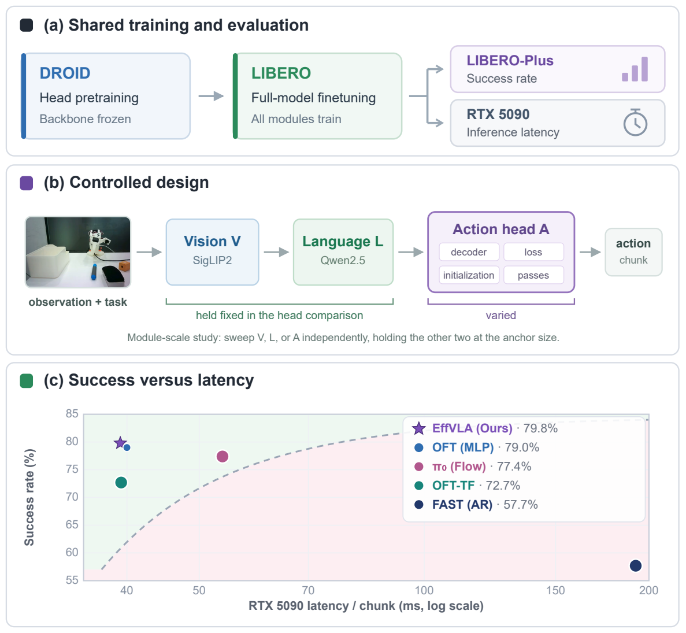
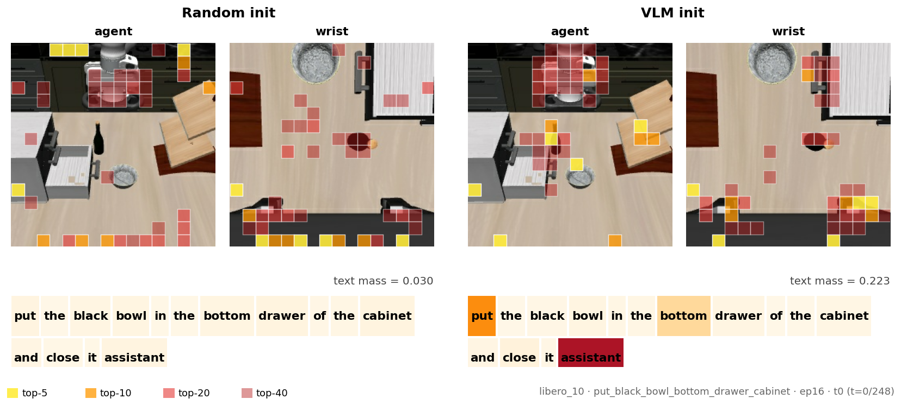
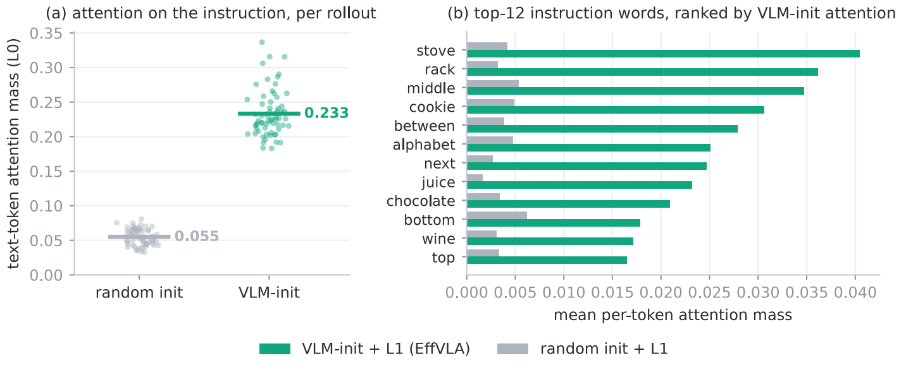
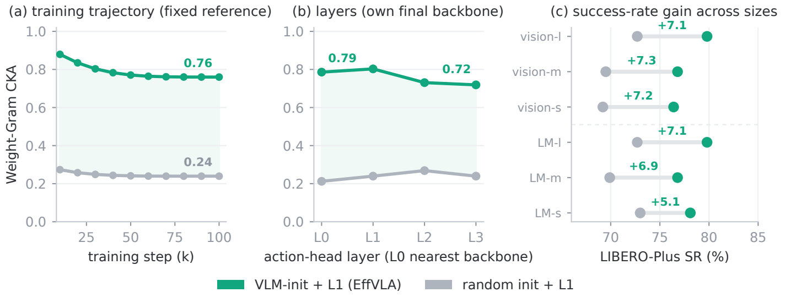
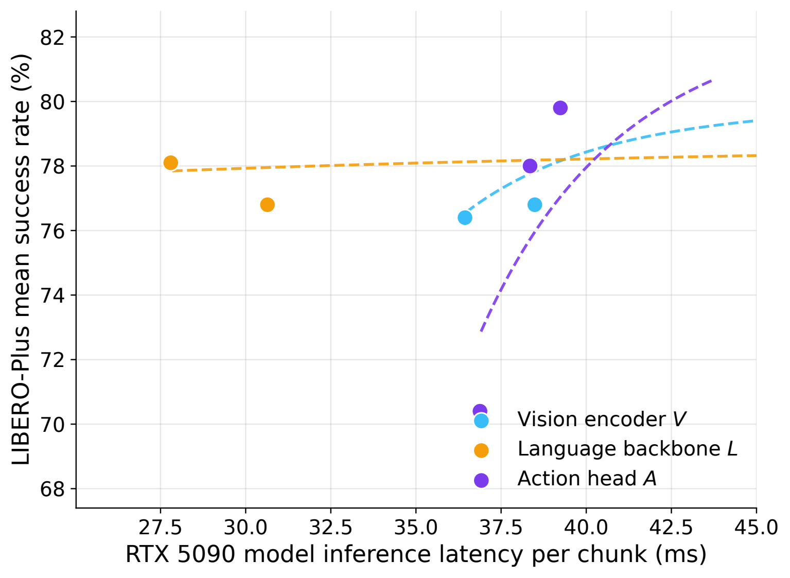
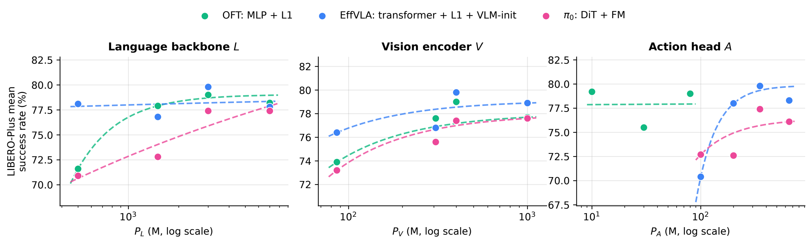
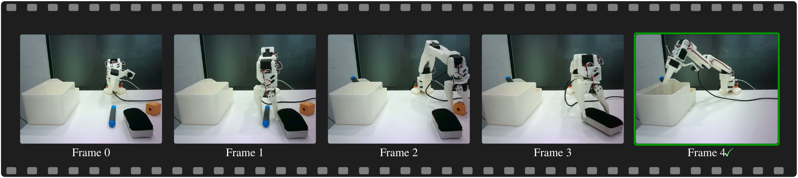

<div align="center">

# How to Build an Efficient VLA
### A Design Space Study for Modular Vision-Language-Action Models
**CoRL 2026**

Luoyang Sun<sup>1,2,*†</sup>, Guoyang Xia<sup>3,4,*</sup>, Fengfa Li<sup>4</sup>, Lei Ren<sup>4,‡§</sup>, Xinyu Cui<sup>1,2</sup>, Haifeng Zhang<sup>1,§</sup>, Fangxiang Feng<sup>3</sup>,<br>Kaike Zhang<sup>4</sup>, Kun Zhan<sup>4</sup>, Yan Xie<sup>4</sup>, Jun Wang<sup>5</sup>, Cheng Deng<sup>6,§</sup>

<sub><sup>1</sup>Institute of Automation, CAS · <sup>2</sup>UCAS · <sup>3</sup>School of Artificial Intelligence, BUPT · <sup>4</sup>Li Auto · <sup>5</sup>UCL · <sup>6</sup>Edinburgh</sub>

<sub>* Equal contribution · ‡ Project leader · § Corresponding authors<br>† Work completed during Luoyang Sun's project internship jointly hosted by AI Lab, The Yangtze River Delta and Li Auto Inc.</sub>

<br>

[](https://arxiv.org/abs/2609.13984) &nbsp;[](https://mindvla-team.github.io/EFFVLA/) &nbsp;[](https://github.com/MindVLA-Team/EFFVLA)

</div>

The arXiv version is titled *What Makes an Efficient VLA? Navigating Action-Head Design, Scaling, and Latency.*

We study action-head design and module scaling under a shared training pipeline, pairing efficiency comparisons with measured latency. The findings select **EffVLA**, a VLM-initialized transformer head with KV sharing and single-pass L1 regression.

This repository provides **EffVLA** and **Pi0** modeling modules for integration with [starVLA](https://github.com/MindVLA-Team). It does not replace the training framework.

<p align="center"></p>

## Three findings

| | Finding | Evidence |
|:--:|:--|:--|
| **1** | **Initialize from the backbone.** Matched L1 heads benefit from VLM initialization without changing inference computation. | **72.7 → 79.8%**, **+7.1** points |
| **2** | **Scale the initialized action head.** Initialization increases its return to capacity. | **+9.4** points for **+2.4 ms**, vs **+3.1** points for the random L1 head |
| **3** | **Returns diminish beyond l.** None of EffVLA's tested g-module probes improves the aggregate LIBERO-Plus score over l. | Saturation within the tested family and benchmark |

The updated OFT-TF latency is **39.3 ms**; EffVLA remains **39.2 ms**, measured on RTX 5090 with an eight-action chunk. The table's difference uses the underlying EffVLA measurement of 39.24 ms: **+0.06 ms**.

Head-family comparisons also change readout interfaces. The random flow-matching head uses DiT, whereas the VLM-initialized flow-matching head uses plain transformer blocks. These comparisons do not all isolate initialization or loss.

## Attention and backbone compatibility

In the black-bowl rollout, instruction attention mass is **0.223** under VLM initialization versus **0.030** under random initialization. The strongest text tokens are `assistant` and `put`; the role token may act as an attention sink. Across **128 rollouts, 64 per condition**, mean text mass is **0.233 vs 0.055**. These observations are consistent with backbone compatibility, not proof of a causal grounding mechanism.

<p align="center">
<br><br>

</p>

<details>
<summary>Additional weight-space analysis in the arXiv version</summary>

Weight-Gram CKA measures projection-weight structure, not input-conditioned activations. The initialized trajectory decreases from **0.88 to 0.76**, versus **0.27 to 0.24** for random initialization. Layerwise values range approximately **0.72–0.81** and **0.21–0.27**. The trajectory uses a fixed pretrained reference; the layerwise panel uses each model's final fine-tuned backbone.



The six success-rate rows represent five unique configurations because the vision-l and LM-l rows share the same l/l/l anchor. Its gain is **+7.1** points.

</details>

## Module scaling

Scaling the action head from s to l gains **9.4 points** with VLM initialization, **3.1** for the matched random L1 head, and **4.7** within the random-initialized flow-matching sweep. These are capacity effects, distinct from initialization gains.

<p align="center">
<br><br>

</p>

Action-head scaling returns about **4.0 points/ms**, versus **1.2** for vision and **0.15** for language. Figure markers show measured configurations; the g latency used by fitted trends is estimated.

## Results

Standard LIBERO by the four task suites (left of **Avg**) and LIBERO-Plus by the seven zero-shot perturbation axes (right). **Bold** = column best, <u>underline</u> = second best.

| Method | Spatial | Object | Goal | Long | Avg | BG | Init | Cam | Lang | Noise | Layout | Light |
|:--|:--:|:--:|:--:|:--:|:--:|:--:|:--:|:--:|:--:|:--:|:--:|:--:|
| OpenVLA | 84.7 | 88.4 | 79.2 | 53.7 | 76.5 | 34.8 | 3.5 | 0.8 | 23.0 | 15.2 | 28.5 | 8.1 |
| π₀ | 98.0 | 96.8 | 94.4 | 88.4 | 94.4 | 81.4 | 6.0 | 13.8 | 58.8 | <u>79.0</u> | 68.9 | 85.0 |
| π₀-FAST | 96.4 | 96.8 | 88.6 | 60.2 | 85.5 | 73.2 | 21.6 | <u>65.1</u> | 61.0 | 74.4 | 68.8 | 73.2 |
| RIPT-VLA | <u>98.6</u> | 98.6 | **99.0** | 93.8 | 97.5 | 91.6 | 31.2 | 55.2 | 77.6 | 73.5 | 74.2 | 88.4 |
| OpenVLA-OFT | 97.6 | 98.4 | <u>97.9</u> | 94.5 | 97.1 | <u>93.3</u> | 31.9 | 56.4 | 79.5 | 75.8 | 74.2 | 88.7 |
| ABot-M0 | **98.8** | **99.8** | **99.0** | **96.6** | **98.6** | 91.6 | <u>67.9</u> | 60.4 | <u>86.4</u> | **86.4** | <u>82.6</u> | <u>96.2</u> |
| **EffVLA (ours)** | <u>98.6</u> | <u>99.2</u> | **99.0** | <u>96.0</u> | <u>98.2</u> | **96.7** | **69.8** | **68.3** | **87.5** | 66.1 | **84.8** | **97.4** |

Success rate (%). Other methods are reported by Yang et al., ABot-M0 (Tables 3 and 4); EffVLA is evaluated by us. Differences in training and backbones prevent treating this table as a controlled comparison. EffVLA leads six of the seven listed LIBERO-Plus perturbation axes and trails on sensor noise.


## Additional evaluations

On SimplerEnv (WidowX), EffVLA scores **61.5%**, compared with **54.2%** for the architecture-matched random transformer, **59.4%** for OFT and **60.5%** for π₀.

Across five training seeds, EffVLA scores **79.0 ± 1.2%** and OFT **77.9 ± 1.5%** (mean ± SD). The mean advantage is **+1.1** points. This checks the close EffVLA–OFT ordering, not the variance of the initialization contrast.

All ten L1 initialization comparisons in the appendix are positive, averaging **+5.8** points. They share data and components and are not ten independent replications.

## Real robot

EffVLA succeeds in **40 of 50** sorting trials on SO-ARM101, using robot-specific training data and the same head and loss.

<p align="center"></p>

| # | Objects | Instruction | Success |
|:--:|:--:|:--|:--:|
| 1 | 1 | *Pick up the yellow cube and place it in the small compartment.* | 10/10 |
| 2 | 1 | *Pick up the blue marker and place it in the medium compartment.* | 9/10 |
| 3 | 2 | *Pick up the blackboard eraser and place it in the large compartment, then pick up the yellow cube and place it in the small compartment.* | 9/10 |
| 4 | 2 | *Pick up the blue marker and place it in the medium compartment, and pick up the yellow cube and place it in the small compartment.* | 7/10 |
| 5 | 3 | *Pick up the blackboard eraser and place it in the large compartment, pick up the blue marker and place it in the medium compartment, and pick up the yellow cube and place it in the small compartment.* | 5/10 |
| | | **Total** | **40/50** |


Ten trials per task. The single-object tasks score 10/10 and 9/10; the three-object task scores 5/10. This is a transfer check without alternative-head baselines.

## Quick start

**1.** Install [starVLA](https://github.com/MindVLA-Team) and set up its environment.

**2.** Add these modules. They mirror starVLA's package layout, so copying the `starVLA/` folder drops each file next to its dependencies; the frameworks auto-register on import.

```bash
git clone https://github.com/MindVLA-Team/EFFVLA
cp -r EFFVLA/starVLA/* /path/to/starVLA/starVLA/
```

**3.** Train, selecting the framework with `--framework.name`:

```bash
accelerate launch \
  --config_file starVLA/config/deepseeds/deepspeed_zero2.yaml \
  starVLA/training/train_starvla.py \
  --config_yaml <your_config>.yaml \
  --framework.name EffVLA          # or: Pi0
```

`EffVLA` deep-copies the backbone's last decoder layers into the action head. The default (`action_head_type: llm_init`) copies them **with weights** — the EffVLA recipe; `llm_init_random` keeps the same architecture but reinitializes the weights, as an ablation.

## Repository layout

```
EffVLA/
├── index.html                     # project page (GitHub Pages)
├── static/                       # figures for the README and the page
└── starVLA/model/                 # ← the drop-in modeling code
    ├── framework/
    │   ├── EffVLA.py               # register name: "EffVLA"
    │   └── Pi0.py                  # register name: "Pi0"
    └── modules/action_model/
        ├── EffVLA_VLMInitHead.py   # VLM-initialized transformer-block L1 head
        ├── Pi0_KVShareHead.py      # flow-matching (π₀) head
        └── flow_matching_head/     # shared encoder for the flow-matching head
```

Everything else these modules import (`base_framework`, the VLM loader, the trainer utilities, and the `FRAMEWORK_REGISTRY`) already lives in starVLA.


## Citation

```bibtex
@inproceedings{sun2026effvla,
  title = {How to Build an Efficient VLA: A Design Space Study for Modular Vision-Language-Action Models},
  author = {Sun, Luoyang and Xia, Guoyang and Li, Fengfa and Ren, Lei and Cui, Xinyu and Zhang, Haifeng and Feng, Fangxiang and Zhang, Kaike and Zhan, Kun and Xie, Yan and Wang, Jun and Deng, Cheng},
  booktitle = {Conference on Robot Learning},
  year = {2026}
}
```

## Acknowledgements

Built on the [starVLA](https://github.com/MindVLA-Team) codebase.

## License

Released under the [Apache 2.0](LICENSE) license.
